# Simulador de una red de distribución de paquetes

**Informe técnico — Proyecto 2**

Teoría de Grafos (INFO1158) · Proyecto práctico final

**Integrantes:** [PENDIENTE: nombre del integrante 1] · [PENDIENTE: nombre del integrante 2] · [PENDIENTE: nombre del integrante 3]

**Docente:** [PENDIENTE: nombre del docente]

**Fecha de entrega:** 26 de noviembre de 2026

**Código fuente:** https://github.com/HectorLep/INFO1158-Simulador-Red-Distribucion-Paquetes

---

## 1. Introducción y planteamiento del problema

Una empresa de distribución opera una red de centros logísticos conectados por rutas de
transporte. Cada ruta tiene un sentido de circulación y una capacidad máxima, expresada en
paquetes por hora. La cantidad que puede llegar desde un centro de origen hasta un centro
de destino no depende solo de las rutas que salen del origen: una ruta amplia resulta
inútil si los enlaces posteriores admiten menos, y la interrupción o la ampliación de una
sola ruta puede cambiar la capacidad de toda la red.

El problema se formula como un **problema de flujo máximo** en una red dirigida con
capacidades. Este informe presenta el modelo matemático, la comparación de dos estrategias
algorítmicas, la implementación propia del algoritmo de Edmonds–Karp, una aplicación
interactiva que calcula y muestra el flujo máximo y un corte mínimo, el análisis de tres
configuraciones de la red y la verificación matemática de los resultados.

## 2. Objetivos

**Objetivo general.** Construir una aplicación interactiva que determine el flujo máximo
entre dos centros de una red logística, identifique un corte mínimo y permita analizar el
efecto de modificar la red.

**Objetivos específicos.**

1. Modelar la red como un grafo dirigido G = (V, E) con una función de capacidad c.
2. Investigar y comparar el método de Ford–Fulkerson con búsqueda en profundidad y el
   algoritmo de Edmonds–Karp, y justificar la elección.
3. Implementar con código propio el algoritmo elegido, con su red residual y sus arcos inversos.
4. Identificar un corte mínimo y comprobar que su capacidad coincide con el flujo máximo.
5. Permitir, desde la interfaz, desactivar rutas, modificar capacidades y agregar conexiones.
6. Comparar la red inicial con dos modificaciones e interpretar las diferencias.
7. Verificar los resultados con un caso resuelto a mano y con comprobaciones automáticas.

## 3. Modelación matemática

### 3.1 Elementos del modelo

La red se representa mediante un grafo dirigido G = (V, E) y una función de capacidad
c : E → {1, 2, …, 12}.

| Elemento | Significado |
|---|---|
| Vértice v ∈ V | Centro logístico |
| Arco (u, v) ∈ E | Ruta de transporte que circula de u hacia v |
| c(u, v) | Máximo de paquetes por hora que admite la ruta |
| s, t ∈ V, s ≠ t | Centro de origen y centro de destino |
| x(u, v) | Flujo: paquetes por hora que se envían por la ruta |

Un flujo x es **factible** si cumple:

- **Capacidad:** 0 ≤ x(u, v) ≤ c(u, v) para todo (u, v) ∈ E.
- **Conservación:** para todo v ∈ V \ {s, t}, Σ x(u, v) (arcos que entran a v) =
  Σ x(v, w) (arcos que salen de v).

El **valor** del flujo es la cantidad neta que sale del origen:
|x| = Σ x(s, v) − Σ x(u, s). El problema consiste en hallar un flujo factible de valor máximo.

Para una partición V = S ∪ T con S ∩ T = ∅, s ∈ S y t ∈ T, la **capacidad del corte** es
c(S, T) = Σ c(u, v) sobre los arcos con u ∈ S y v ∈ T.

*Nota de notación.* Como en el enunciado, la letra T designa tanto el vértice de destino
como el conjunto del corte que lo contiene; el contexto los distingue. Así, «T = {G, T}»
significa que el conjunto T está formado por los vértices G y T.

### 3.2 Configuración inicial

V = {O, A, B, C, D, E, F, G, H, I, T}, con |V| = 11. Origen s = O, destino t = T.

| Vértice | Centro | Vértice | Centro |
|---|---|---|---|
| O | Centro de origen (planta de clasificación) | F | Centro de distribución 3 |
| A | Centro regional norte | G | Centro de distribución 4 |
| B | Centro regional central | H | Centro de reparto norte |
| C | Centro regional sur | I | Centro de reparto sur |
| D | Centro de distribución 1 | T | Centro de destino |
| E | Centro de distribución 2 | | |

E tiene 18 arcos. Valores de c (paquetes por hora):

| Arco | c | Arco | c | Arco | c |
|---|---:|---|---:|---|---:|
| O → A | 8 | B → F | 4 | E → I | 4 |
| O → B | 7 | C → F | 5 | F → I | 6 |
| O → C | 5 | C → G | 3 | F → T | 2 |
| A → D | 6 | D → H | 6 | G → T | 3 |
| A → E | 3 | D → I | 2 | H → T | 8 |
| B → E | 6 | E → H | 5 | I → T | 5 |

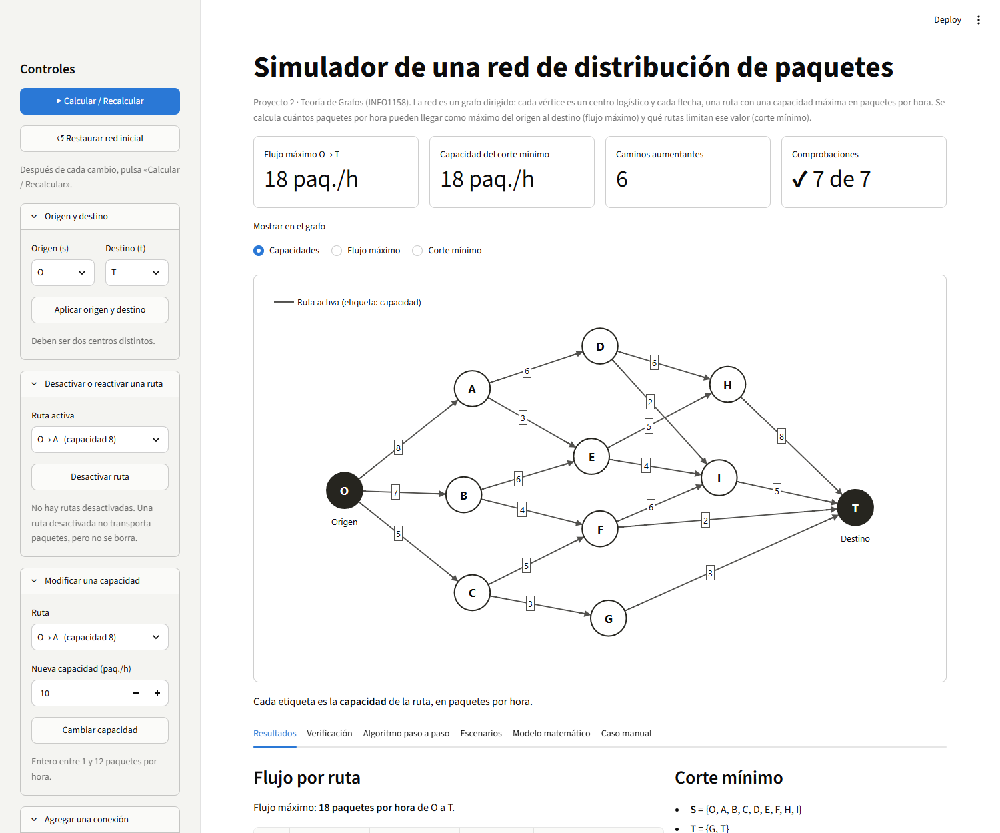

*Figura 1. Red inicial en la aplicación (modo «Capacidades»). Captura real de la ejecución.*

### 3.3 Cumplimiento de las restricciones del enunciado

Las siguientes condiciones las comprueba el propio programa (función
`comprobar_condiciones_iniciales`, pestaña «Modelo matemático» y pruebas automáticas):

| Condición del enunciado | Valor en la red inicial | Cumple |
|---|---|---|
| 10 ≤ \|V\| ≤ 12 | \|V\| = 11 | Sí |
| 15 ≤ \|E\| ≤ 20 | \|E\| = 18 | Sí |
| c : E → {1, …, 12} | mínima 2, máxima 8, todas enteras | Sí |
| Sin lazos, arcos repetidos ni recíprocos | ninguno | Sí |
| Ningún vértice aislado | ninguno | Sí |
| s ≠ t | O ≠ T | Sí |
| Al menos dos caminos dirigidos distintos de s a t | 11 caminos distintos | Sí |

Los intervalos de |V| y |E| se exigen solo a la configuración inicial; las modificaciones
hechas desde la interfaz pueden cambiar el número de arcos. La prohibición de lazos, arcos
repetidos y recíprocos, y el rango 1–12 de las capacidades, se aplican siempre.

## 4. Investigación y comparación de algoritmos

### 4.1 El método de Ford–Fulkerson

Ford y Fulkerson [2] formularon el problema de flujo máximo y demostraron que el valor
máximo de un flujo coincide con la capacidad mínima de un corte. El método que lleva su
nombre [1] parte de un flujo nulo y lo mejora repetidamente:

1. Se construye la **red residual** del flujo actual. Por cada arco (u, v) con capacidad c
   y flujo x contiene un arco directo u → v de capacidad c − x (si c − x > 0) y un arco
   inverso v → u de capacidad x (si x > 0).
2. Se busca en ella un **camino aumentante**, es decir, un camino de s a t.
3. Si existe, se aumenta el flujo a lo largo del camino en la cantidad de su **cuello de
   botella** (la menor capacidad residual del camino). En los arcos inversos, aumentar
   significa disminuir el flujo del arco original.
4. Si no existe, el flujo es máximo.

El método no especifica cómo se elige el camino aumentante. Esa elección da lugar a las
dos estrategias comparadas.

### 4.2 Estrategia A: Ford–Fulkerson con búsqueda en profundidad (DFS)

El camino aumentante se obtiene con una búsqueda en profundidad: se avanza por el primer
arco residual disponible y se retrocede cuando no se puede continuar. Con capacidades
enteras, cada aumento incrementa el valor al menos en una unidad, por lo que el método
termina tras, a lo sumo, |x\*| aumentos (siendo |x\*| el valor del flujo máximo). Como cada
búsqueda cuesta O(|E|), el tiempo total es O(|E| · |x\*|) [1]. El número de iteraciones
depende, por tanto, de los valores de las capacidades y no solo del tamaño de la red.

### 4.3 Estrategia B: algoritmo de Edmonds–Karp (BFS)

Edmonds y Karp [3] propusieron elegir siempre un camino aumentante con el menor número de
arcos, lo que se consigue con una búsqueda en anchura (BFS) sobre la red residual. Es una
**variante del método de Ford–Fulkerson**: conserva su estructura y solo fija la regla de
selección. Con esa regla, el número de aumentos es O(|V| · |E|) y el tiempo total
O(|V| · |E|²), independientemente de las capacidades [1], [3].

### 4.4 Comparación

| Característica | Ford–Fulkerson con DFS | Edmonds–Karp (BFS) |
|---|---|---|
| Selección del camino aumentante | El primero que encuentra la búsqueda en profundidad | El de menor número de arcos |
| Corrección con capacidades enteras | Sí | Sí |
| Número de aumentos | Hasta \|x\*\|: depende de las capacidades | O(\|V\| · \|E\|): no depende de las capacidades |
| Tiempo en el peor caso | O(\|E\| · \|x\*\|) | O(\|V\| · \|E\|²) |
| Forma de los caminos | Pueden ser largos y usar arcos inversos con frecuencia | Los más cortos posibles |
| Reproducibilidad a mano | Depende del orden de exploración | Alta: procede por niveles |
| Estructura auxiliar | Pila o recursión | Cola |

**Comparación experimental con el código propio.** La implementación incluye la búsqueda
en profundidad únicamente para contrastar ambas estrategias. Resultados obtenidos al
ejecutar el programa:

| Configuración | Valor (BFS) | Valor (DFS) | Aumentos (BFS) | Aumentos (DFS) | Camino más largo (BFS / DFS) |
|---|---:|---:|---:|---:|---|
| Red inicial | 18 | 18 | 6 | 6 | 4 arcos / 6 arcos |
| Desactivar H → T | 10 | 10 | 4 | 4 | 4 arcos / 4 arcos |
| I → T con capacidad 10 | 20 | 20 | 7 | 7 | 4 arcos / 6 arcos |

Ambas estrategias obtienen el mismo valor máximo, como exige la teoría, y en una red de
este tamaño realizan el mismo número de aumentos. La diferencia observable está en los
caminos: en la red inicial, el segundo camino que encuentra DFS es
O → A → E → H → D → I → T, de seis arcos, que utiliza el arco inverso H → D para devolver
dos unidades asignadas antes a D → H; con BFS ningún camino supera los cuatro arcos ni
requiere arcos inversos.

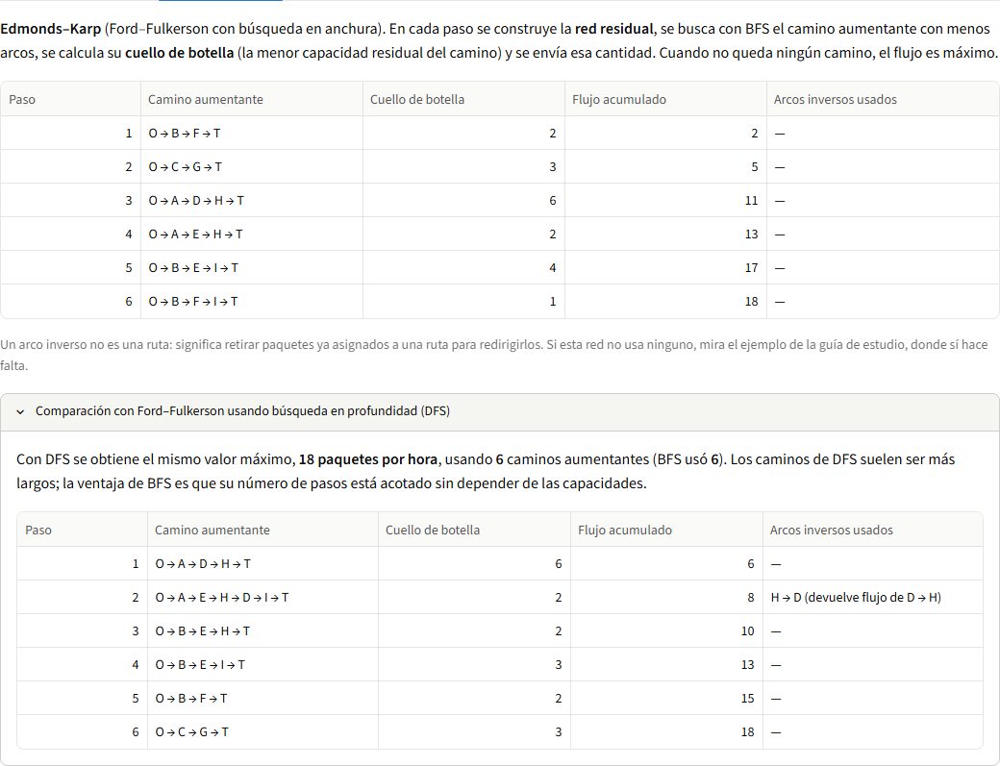

*Figura 2. Pestaña «Algoritmo paso a paso»: caminos aumentantes de Edmonds–Karp y, debajo,
los que produce la búsqueda en profundidad sobre la misma red.*

## 5. Justificación del algoritmo seleccionado

Se seleccionó el **algoritmo de Edmonds–Karp** por las siguientes razones:

1. **Cota independiente de las capacidades.** Su número de aumentos está acotado por
   O(|V| · |E|) [1], [3]. Aunque en este proyecto las capacidades son pequeñas (1 a 12), la
   garantía no depende de ese supuesto.
2. **Procedimiento sistemático y verificable.** La búsqueda en anchura explora por niveles
   y siempre devuelve un camino con el menor número de arcos, de modo que la ejecución
   puede reproducirse a mano y contrastarse paso a paso con el programa (sección 10).
3. **Economía de implementación.** La misma búsqueda en anchura sirve para hallar los
   caminos aumentantes y, sobre la red residual final, para obtener el conjunto S del corte
   mínimo.
4. **Claridad.** El código resultante es breve y cada función corresponde a un concepto de
   la teoría (red residual, camino aumentante, cuello de botella, aumento, corte).

*Procedencia de las afirmaciones:* las definiciones y restricciones provienen del
enunciado; las cotas de complejidad y el teorema de flujo máximo–corte mínimo, de la
bibliografía [1]–[5]; los resultados numéricos y la comparación experimental, de la
ejecución del código propio.

## 6. Implementación

### 6.1 Organización del código

El programa está escrito en Python, sin bibliotecas de grafos. Se usan únicamente
diccionarios, listas, conjuntos y la cola `collections.deque`.

| Archivo | Responsabilidad |
|---|---|
| `grafo.py` | Representación de la red y modificaciones válidas |
| `algoritmos.py` | Red residual, búsqueda de caminos, flujo máximo y corte mínimo |
| `verificacion.py` | Comprobaciones matemáticas y escenarios de comparación |
| `dibujo.py` | Figura del grafo (Plotly, solo representación) |
| `app.py` | Interfaz (Streamlit) |
| `tests/` | 81 pruebas automáticas con `unittest` |

### 6.2 Representación de la red

La red es un diccionario con la lista de vértices, el origen, el destino y la lista de
arcos; cada arco guarda `origen`, `destino`, `capacidad` y `activo`. Una ruta desactivada
conserva su registro con `activo = False`, lo que permite reactivarla. La función
`capacidades_activas(red)` devuelve el diccionario (u, v) → c(u, v) con las rutas activas y
es el único punto de entrada de los cálculos: una ruta desactivada no puede intervenir en
el flujo ni en el corte.

### 6.3 Funciones principales del algoritmo

| Función | Entradas | Resultado |
|---|---|---|
| `construir_red_residual` | vértices, capacidades, flujo | `residual[u][v]`: capacidad residual (solo valores positivos) |
| `recorrer_en_anchura` | red residual, vértice inicial | diccionario `padre` de los vértices alcanzables |
| `buscar_camino_en_anchura` | red residual, s, t | camino aumentante con menos arcos, o `None` |
| `calcular_cuello_de_botella` | red residual, camino | menor capacidad residual del camino |
| `aumentar_flujo` | flujo, camino, cantidad | actualiza el flujo: suma en arcos directos, resta en inversos |
| `calcular_flujo_maximo` | vértices, capacidades, s, t | flujo final y lista de pasos |
| `encontrar_corte_minimo` | vértices, capacidades, flujo, s | S, T, arcos del corte y su capacidad |

Código del núcleo del algoritmo, tomado de `algoritmos.py`. Para abreviar se omiten aquí
los comentarios de documentación de cada función y, en el ciclo principal, la opción de
búsqueda en profundidad (usada solo en la comparación) y el registro de los pasos que
muestra la interfaz; el código completo está en el enlace de la sección 15.

```python
def construir_red_residual(vertices, capacidades, flujo):
    residual = {}
    for vertice in vertices:
        residual[vertice] = {}
    for (u, v), capacidad in capacidades.items():
        disponible = capacidad - flujo[(u, v)]
        if disponible > 0:
            residual[u][v] = disponible            # arco directo
        if flujo[(u, v)] > 0:
            residual[v][u] = flujo[(u, v)]         # arco inverso
    return residual

def aumentar_flujo(flujo, camino, cantidad):
    for u, v in arcos_de_camino(camino):
        if (u, v) in flujo:
            flujo[(u, v)] += cantidad
        else:
            flujo[(v, u)] -= cantidad

# Ciclo principal de calcular_flujo_maximo
flujo = {}
for arco in capacidades:
    flujo[arco] = 0
while True:
    residual = construir_red_residual(vertices, capacidades, flujo)
    camino = buscar_camino_en_anchura(residual, origen, destino)
    if camino is None:
        break                                  # sin camino aumentante: flujo máximo
    cuello = calcular_cuello_de_botella(residual, camino)
    aumentar_flujo(flujo, camino, cuello)
```

**Arcos inversos.** En `aumentar_flujo`, para cada arco residual (u, v) del camino: si
(u, v) es una ruta original, su flujo aumenta; en caso contrario, el arco es el inverso de
la ruta original (v, u) y el flujo de esta disminuye. Como el modelo prohíbe arcos
recíprocos, esa distinción no es ambigua; `comprobar_red_admisible` rechaza cualquier red
que no cumpla esa condición.

**Terminación.** Las capacidades son enteras, por lo que cada aumento incrementa el valor
al menos en una unidad y el valor está acotado por la capacidad que sale del origen.

**Corte mínimo.** `encontrar_corte_minimo` construye la red residual del flujo final,
obtiene con la búsqueda en anchura los vértices alcanzables desde s (conjunto S), define T
como el resto y toma como corte los arcos originales activos con origen en S y destino en T.

### 6.4 Verificación incorporada al programa

Cada resultado que muestra la aplicación pasa por `verificar_resultado`, que comprueba:

1. 0 ≤ x(u, v) ≤ c(u, v) en cada ruta activa.
2. Conservación del flujo en cada vértice intermedio.
3. Valor del flujo = flujo neto que sale del origen.
4. El mismo valor llega, neto, al destino.
5. Partición válida: s ∈ S, t ∈ T y cada vértice en un solo conjunto.
6. Los arcos del corte van de S a T y están saturados; los arcos de T a S no llevan flujo.
7. Flujo máximo = capacidad del corte mínimo.

### 6.5 Documentación del código

Cada función principal incluye un comentario de documentación con su finalidad, sus
entradas, su resultado y, cuando corresponde, la razón matemática por la que funciona.

## 7. Descripción de la interfaz

La aplicación se ejecuta en el navegador mediante Streamlit.

- **Zona superior:** título, descripción e indicadores (flujo máximo, capacidad del corte
  mínimo, número de caminos aumentantes y comprobaciones cumplidas).
- **Panel lateral:** botones «Calcular / Recalcular» y «Restaurar red inicial»; selección
  de origen y destino; desactivación y reactivación de rutas; modificación de capacidades
  (entero de 1 a 12); incorporación de conexiones.
- **Zona principal:** el grafo, con tres modos de visualización: *Capacidades*, *Flujo
  máximo* (etiquetas flujo/capacidad, grosor proporcional al flujo y rutas saturadas
  destacadas) y *Corte mínimo* (conjuntos S y T en colores distintos y rutas del corte en
  rojo discontinuo).
- **Zona inferior (pestañas):** resultados por ruta y corte mínimo; verificación; algoritmo
  paso a paso; escenarios; modelo matemático; caso manual.

Tras cada modificación la aplicación oculta los resultados anteriores y solicita el
recálculo, de modo que nunca se muestran valores que no correspondan a la red visible. Las
conexiones prohibidas (lazos, repetidas, recíprocas) y la selección s = t se rechazan con
un mensaje y sin alterar la red.

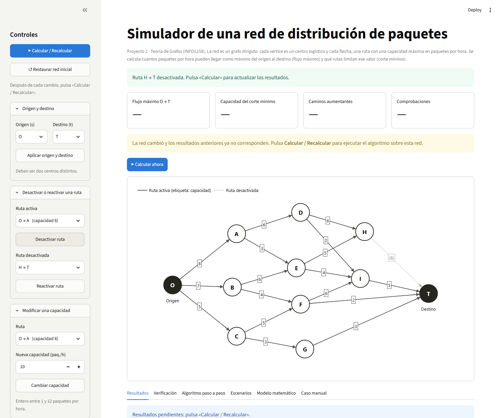

*Figura 3. Tras desactivar H → T, la aplicación pide recalcular y no muestra resultados antiguos.*

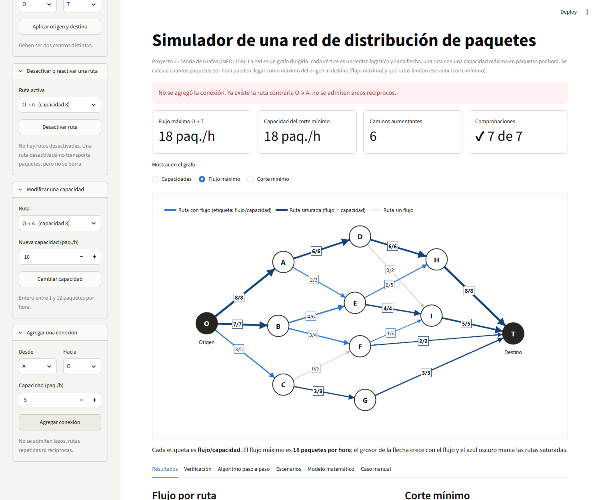

*Figura 4. Intento de agregar A → O: se rechaza por ser recíproca de O → A.*

## 8. Resultados de la red original

**Flujo máximo: 18 paquetes por hora.** Flujo asignado a cada arco (flujo/capacidad):

| Arco | x/c | Arco | x/c | Arco | x/c |
|---|---:|---|---:|---|---:|
| O → A | 8/8 | B → F | 3/4 | E → I | 4/4 |
| O → B | 7/7 | C → F | 0/5 | F → I | 1/6 |
| O → C | 3/5 | C → G | 3/3 | F → T | 2/2 |
| A → D | 6/6 | D → H | 6/6 | G → T | 3/3 |
| A → E | 2/3 | D → I | 0/2 | H → T | 8/8 |
| B → E | 4/6 | E → H | 2/5 | I → T | 5/5 |

Caminos aumentantes utilizados por Edmonds–Karp:

| Paso | Camino aumentante | Cuello de botella | Flujo acumulado |
|---|---|---:|---:|
| 1 | O → B → F → T | 2 | 2 |
| 2 | O → C → G → T | 3 | 5 |
| 3 | O → A → D → H → T | 6 | 11 |
| 4 | O → A → E → H → T | 2 | 13 |
| 5 | O → B → E → I → T | 4 | 17 |
| 6 | O → B → F → I → T | 1 | 18 |

**Corte mínimo.** S = {O, A, B, C, D, E, F, H, I}, T = {G, T}. Arcos de S a T: C → G (3),
F → T (2), H → T (8), I → T (5). Capacidad: c(S, T) = 3 + 2 + 8 + 5 = **18**, igual al
flujo máximo.

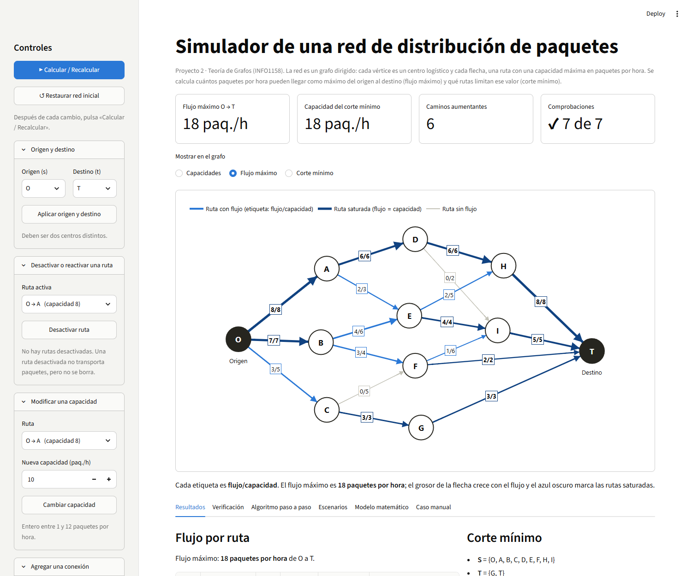

*Figura 5. Flujo máximo de la red inicial: 18 paquetes por hora.*

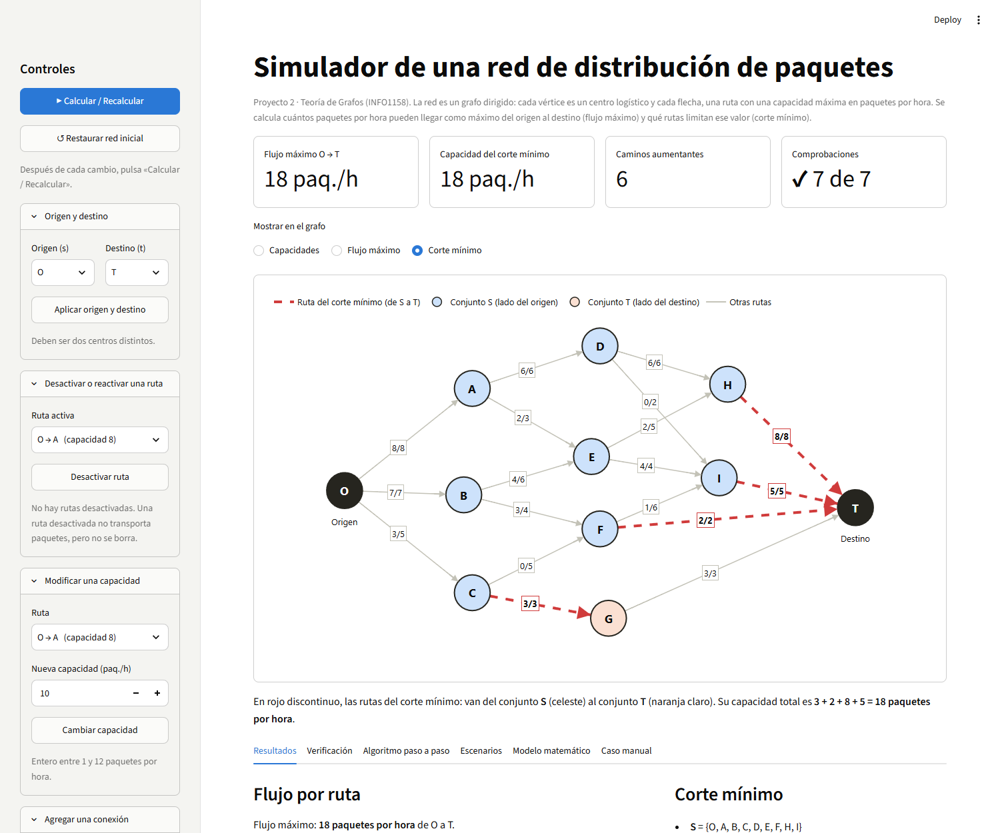

*Figura 6. Corte mínimo de la red inicial: conjunto S (celeste), conjunto T (naranja claro)
y rutas del corte (rojo discontinuo).*

**Interpretación.** Del origen podrían salir 8 + 7 + 5 = 20 paquetes por hora, pero solo
llegan 18: el cuello de botella se encuentra en las rutas próximas al destino, todas
saturadas. El corte mínimo no es único: el conjunto de los cuatro arcos que entran en T,
{F → T, G → T, H → T, I → T}, también tiene capacidad 2 + 3 + 8 + 5 = 18.

## 9. Análisis de dos modificaciones

Las dos modificaciones se aplican por separado sobre copias de la red original, con el
mismo origen O y destino T.

| Configuración | Flujo máximo | Corte mínimo hallado | Capacidad del corte | S | T |
|---|---:|---|---:|---|---|
| Red inicial | 18 | {C→G (3), F→T (2), H→T (8), I→T (5)} | 18 | {O, A, B, C, D, E, F, H, I} | {G, T} |
| Modificación 1: desactivar H → T | 10 | {C→G (3), F→T (2), I→T (5)} | 10 | {O, A, B, C, D, E, F, H, I} | {G, T} |
| Modificación 2: capacidad de I → T de 5 a 10 | 20 | {O→A (8), O→B (7), O→C (5)} | 20 | {O} | {A, B, C, D, E, F, G, H, I, T} |

### 9.1 Modificación 1: desactivar la ruta H → T

El flujo máximo desciende de 18 a 10 paquetes por hora. Se pierden exactamente los 8
paquetes por hora de la ruta desactivada, porque H → T pertenecía al corte mínimo y las
demás rutas que llegan al destino ya estaban saturadas: no existe capacidad alternativa
que absorba esa carga. El centro H queda sin salida y deja de recibir paquetes (D → H y
E → H pasan a 0/6 y 0/5). Flujo resultante:

O→A 5/8, O→B 2/7, O→C 3/5, A→D 2/6, A→E 3/3, B→E 0/6, B→F 2/4, C→F 0/5, C→G 3/3, D→H 0/6,
D→I 2/2, E→H 0/5, E→I 3/4, F→I 0/6, F→T 2/2, G→T 3/3, I→T 5/5.

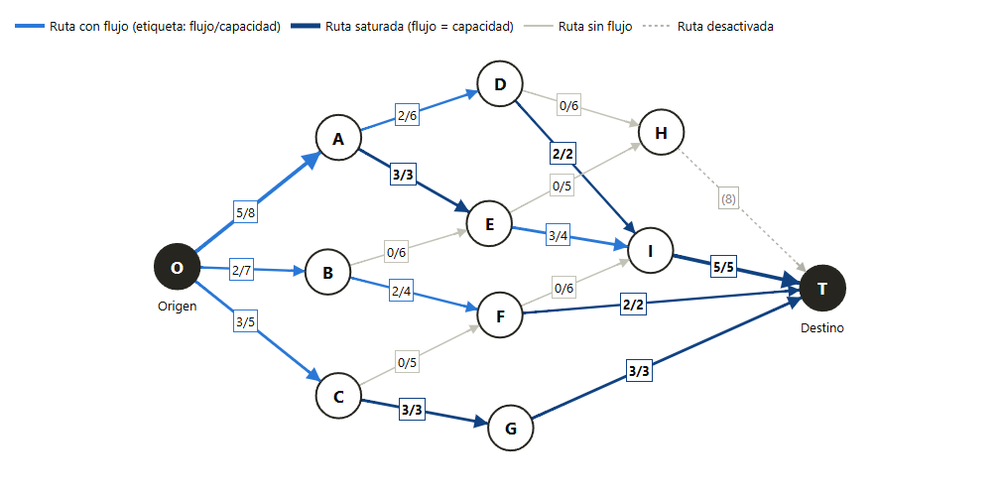

*Figura 7. Modificación 1 (H → T desactivada, en punteado): flujo máximo de 10 paquetes por hora.*

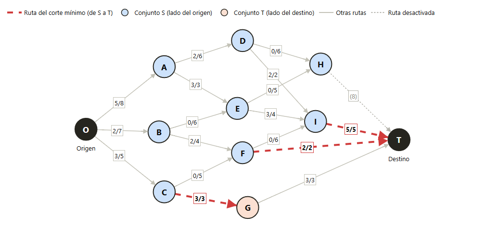

*Figura 8. Modificación 1: corte mínimo {C → G, F → T, I → T}, de capacidad 3 + 2 + 5 = 10.*

### 9.2 Modificación 2: aumentar la capacidad de I → T de 5 a 10

El flujo máximo aumenta de 18 a 20 paquetes por hora: sube 2 y no 5. Al ampliar I → T
desaparece el cuello de botella cercano al destino, pero aparece otro: las rutas que salen
del origen solo admiten 8 + 7 + 5 = 20. El corte mínimo pasa a ser {O → A, O → B, O → C} y
la ruta ampliada queda con capacidad sobrante (7/10). Flujo resultante:

O→A 8/8, O→B 7/7, O→C 5/5, A→D 6/6, A→E 2/3, B→E 4/6, B→F 3/4, C→F 2/5, C→G 3/3, D→H 6/6,
D→I 0/2, E→H 2/5, E→I 4/4, F→I 3/6, F→T 2/2, G→T 3/3, H→T 8/8, I→T 7/10.

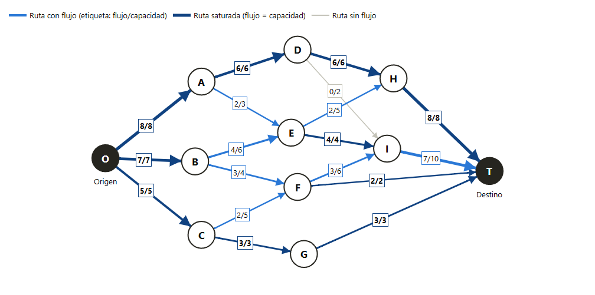

*Figura 9. Modificación 2 (I → T con capacidad 10): flujo máximo de 20 paquetes por hora.*

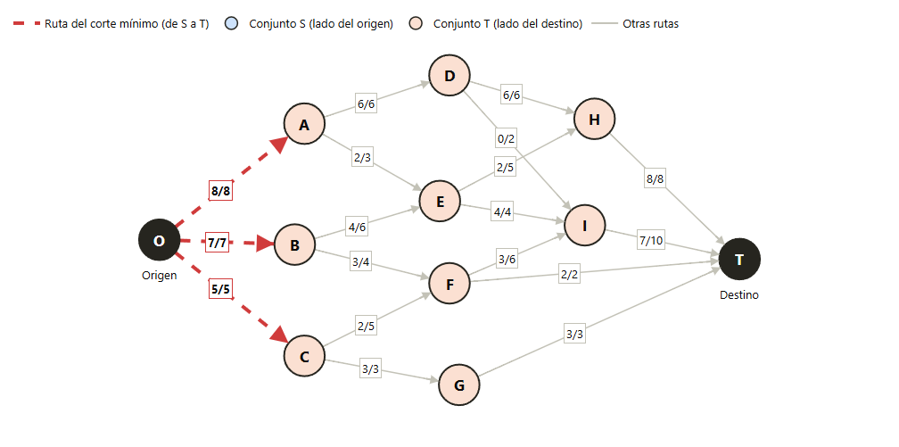

*Figura 10. Modificación 2: el corte mínimo se traslada a las rutas que salen del origen.*

### 9.3 Síntesis

- La pérdida de una ruta del corte mínimo reduce el flujo en toda su capacidad cuando no
  hay alternativas con holgura.
- La ampliación de una ruta del corte mejora el flujo solo hasta que otro corte pasa a
  ser el limitante.
- En ambos casos el corte mínimo indica dónde intervenir: señala las rutas saturadas que
  determinan la capacidad de la red.

### 9.4 Comprobaciones en las tres configuraciones

| Comprobación | Red inicial | Modificación 1 | Modificación 2 |
|---|---|---|---|
| 0 ≤ x ≤ c en cada ruta activa | Cumple (18 rutas) | Cumple (17 rutas) | Cumple (18 rutas) |
| Conservación en los 9 vértices intermedios | Cumple | Cumple | Cumple |
| Valor = flujo neto que sale de O | 18 − 0 = 18 | 10 − 0 = 10 | 20 − 0 = 20 |
| Valor = flujo neto que llega a T | 18 | 10 | 20 |
| Arcos del corte saturados; ningún flujo de T a S | Cumple | Cumple | Cumple |
| Flujo máximo = capacidad del corte | 18 = 3+2+8+5 | 10 = 3+2+5 | 20 = 8+7+5 |

Conservación en la red inicial, vértice por vértice (entra = sale): A 8, B 7, C 3, D 6,
E 6, F 3, G 3, H 8, I 5.

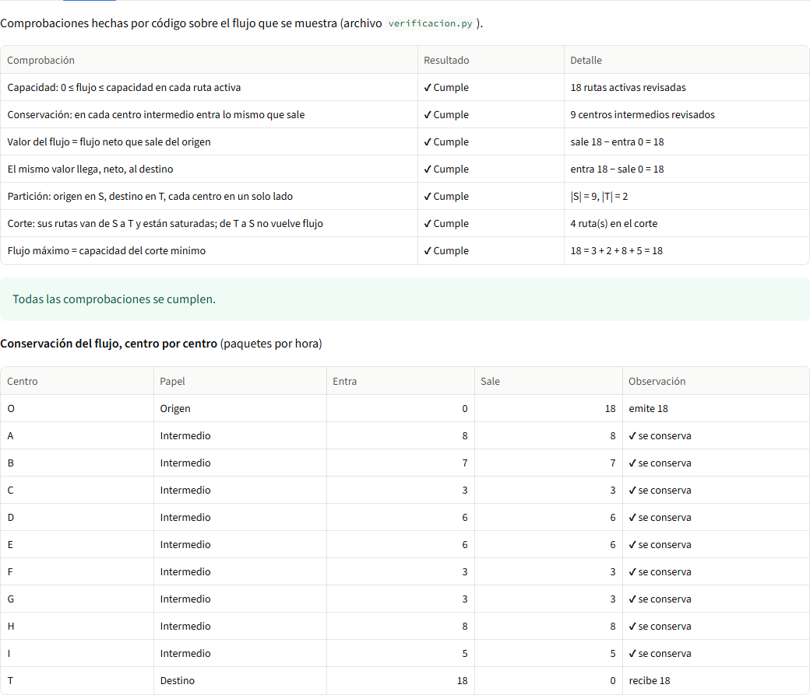

*Figura 11. Pestaña «Verificación» para la red inicial.*

## 10. Verificación matemática manual

### 10.1 Caso de comprobación

Red independiente de cinco vértices: V = {O, A, B, C, T}, s = O, t = T, con los arcos

O → A (6), O → B (4), A → C (3), A → T (3), B → C (4), C → T (5).

### 10.2 Un flujo factible

Se envían 3 paquetes por hora por O → A → T, 2 por O → A → C → T y 3 por O → B → C → T:

| Arco | Capacidad | Flujo | ¿0 ≤ x ≤ c? |
|---|---:|---:|---|
| O → A | 6 | 3 + 2 = 5 | Sí |
| O → B | 4 | 3 | Sí |
| A → C | 3 | 2 | Sí |
| A → T | 3 | 3 | Sí |
| B → C | 4 | 3 | Sí |
| C → T | 5 | 2 + 3 = 5 | Sí |

Conservación: en A entran 5 y salen 2 + 3 = 5; en B entran 3 y salen 3; en C entran
2 + 3 = 5 y salen 5. Valor del flujo: |x| = x(O, A) + x(O, B) = 5 + 3 = **8**.

### 10.3 Un corte de la misma capacidad

Sea S = {O, A, B, C} y T = {T}. Los arcos de S a T son A → T y C → T, de modo que
c(S, T) = 3 + 5 = **8**.

### 10.4 Optimalidad

Para cualquier flujo factible x y cualquier corte (S, T) se cumple |x| ≤ c(S, T), porque
todo el flujo que llega a t debe atravesar los arcos de S a T y no puede superar la suma
de sus capacidades. Como se ha exhibido un flujo de valor 8 y un corte de capacidad 8, no
puede existir un flujo de valor mayor ni un corte de capacidad menor: el flujo es máximo
y el corte es mínimo.

### 10.5 Ejecución manual de Edmonds–Karp

| Paso | Red residual (arcos con capacidad positiva) | Camino (BFS) | Cuello | Valor |
|---|---|---|---:|---:|
| 1 | O→A 6, O→B 4, A→C 3, A→T 3, B→C 4, C→T 5 | O → A → T | 3 | 3 |
| 2 | O→A 3, O→B 4, A→O 3, A→C 3, B→C 4, C→T 5, T→A 3 | O → A → C → T | 3 | 6 |
| 3 | O→B 4, A→O 6, B→C 4, C→A 3, C→T 2, T→A 3, T→C 3 | O → B → C → T | 2 | 8 |
| 4 | O→B 2, A→O 6, B→O 2, B→C 2, C→A 3, C→B 2, T→A 3, T→C 5 | no existe | — | 8 |

En el paso 4, desde O solo se alcanzan B, C y A: S = {O, A, B, C}, T = {T}.

## 11. Comparación con los resultados del código

| Concepto | Resolución manual | Código |
|---|---|---|
| Flujo O → A | 5 | 6 |
| Flujo O → B | 3 | 2 |
| Flujo A → C | 2 | 3 |
| Flujo A → T | 3 | 3 |
| Flujo B → C | 3 | 2 |
| Flujo C → T | 5 | 5 |
| Flujo factible (capacidad y conservación) | Sí | Sí |
| **Valor del flujo** | **8** | **8** |
| Corte | {A → T (3), C → T (5)} | {A → T (3), C → T (5)} |
| **Capacidad del corte** | **8** | **8** |
| Caminos aumentantes | — | O→A→T (3), O→A→C→T (3), O→B→C→T (2) |

**Diferencia encontrada y explicación.** El valor del flujo y el corte coinciden. La
distribución por arco difiere en O → A, O → B, A → C y B → C. El flujo manual se construyó
repartiendo la carga entre los tres trayectos; el código, al elegir primero los caminos más
cortos, satura O → A (6) y solo necesita 2 unidades por O → B. Ambos flujos son factibles y
de valor 8. El valor del flujo máximo es único, pero puede existir más de una distribución
que lo alcance. La ejecución manual de Edmonds–Karp (sección 10.5) reproduce exactamente
los pasos y el flujo que entrega el programa.

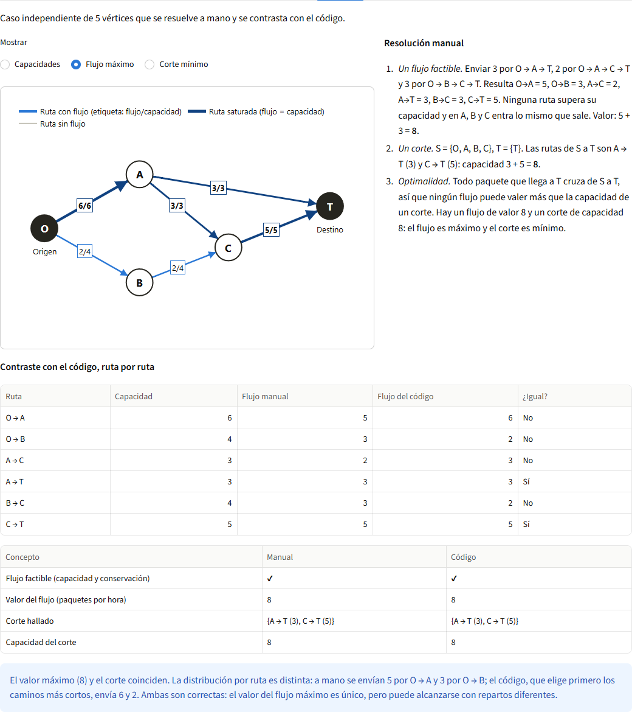

*Figura 12. Pestaña «Caso manual»: resolución a mano y contraste con el código.*

**Evidencia adicional.** Las pruebas automáticas (81 en total, todas superadas en la
ejecución del 14/11/2026) incluyen: el caso manual; los tres escenarios; el uso correcto
de arcos inversos en una red donde son imprescindibles; el cálculo del corte mínimo por
enumeración exhaustiva de las 512 particiones posibles, que coincide con el flujo máximo
en los tres escenarios y en las 110 parejas origen–destino de la red; la coincidencia de
valores entre BFS y DFS; y el funcionamiento de los controles de la interfaz.

## 12. Conclusiones

1. El problema de distribución se modela de forma natural como un flujo máximo en un
   grafo dirigido con capacidades; las restricciones de capacidad y conservación traducen
   directamente las condiciones físicas de la red.
2. El algoritmo de Edmonds–Karp resuelve el problema con una implementación breve y
   comprensible, y aporta una cota de ejecución que no depende de las capacidades.
3. Los arcos inversos de la red residual son indispensables: permiten redirigir flujo ya
   asignado y sin ellos el método puede detenerse en un flujo no máximo.
4. El corte mínimo obtenido de la red residual final certifica la optimalidad del flujo
   (flujo máximo = capacidad del corte mínimo) e identifica las rutas que limitan la red.
5. El análisis de modificaciones muestra que el efecto de un cambio depende de su relación
   con el corte mínimo: desactivar H → T reduce el flujo de 18 a 10, mientras que ampliar
   I → T en 5 unidades solo lo aumenta en 2, porque el cuello de botella se desplaza.
6. La verificación manual y las comprobaciones automáticas coinciden con los resultados
   del programa; las diferencias en la distribución del flujo se explican por la no
   unicidad del flujo máximo.

## 13. Fuentes académicas y técnicas

[1] Cormen, T. H., Leiserson, C. E., Rivest, R. L. y Stein, C. (2022). *Introduction to
Algorithms* (4.ª ed.). MIT Press. ISBN 978-0-262-04630-5. Capítulos «Elementary Graph
Algorithms» (búsqueda en anchura y en profundidad) y «Maximum Flow» (método de
Ford–Fulkerson, algoritmo de Edmonds–Karp, teorema de flujo máximo–corte mínimo).

[2] Ford, L. R. y Fulkerson, D. R. (1956). Maximal flow through a network. *Canadian
Journal of Mathematics*, 8, 399–404. https://doi.org/10.4153/CJM-1956-045-5

[3] Edmonds, J. y Karp, R. M. (1972). Theoretical improvements in algorithmic efficiency
for network flow problems. *Journal of the ACM*, 19(2), 248–264.
https://doi.org/10.1145/321694.321699

[4] Kleinberg, J. y Tardos, É. (2006). *Algorithm Design*. Pearson/Addison-Wesley.
Capítulo 7, «Network Flow». Material docente asociado (K. Wayne):
https://www.cs.princeton.edu/~wayne/kleinberg-tardos/pdf/07NetworkFlowII.pdf

[5] Sedgewick, R. y Wayne, K. (2011). *Algorithms* (4.ª ed.). Addison-Wesley. Sección 6.4,
«Maximum Flow». Sitio del libro: https://algs4.cs.princeton.edu/64maxflow

[6] Streamlit. *Documentación oficial*. https://docs.streamlit.io

[7] Plotly. *Plotly Python Open Source Graphing Library*. https://plotly.com/python/

Los datos bibliográficos de [1] a [3] y la disponibilidad de los recursos en línea de [4]
y [5] se comprobaron el 13 de noviembre de 2026.

## 14. Dependencias e instrucciones de ejecución

- Python 3.11 o posterior (probado con 3.13.5).
- `streamlit==1.67.0`, `plotly==7.1.0`, `pandas==3.1.1` (archivo `proyecto2/requirements.txt`).

Desde la carpeta raíz del repositorio, en PowerShell:

```powershell
python -m pip install -r proyecto2/requirements.txt
python -m streamlit run proyecto2/app.py
python -m unittest discover -s proyecto2/tests -v
python proyecto2/verificacion.py
```

El primer comando instala las dependencias; el segundo abre la aplicación en
`http://localhost:8501`; el tercero ejecuta las pruebas; el cuarto imprime en consola los
resultados de las tres configuraciones y del caso manual.

## 15. Enlace al código fuente

Repositorio de GitHub (privado; el acceso se concede al docente como colaborador):

https://github.com/HectorLep/INFO1158-Simulador-Red-Distribucion-Paquetes

Contiene la carpeta `proyecto2/` completa (código, datos, pruebas, `requirements.txt` y
`README.md`), los datos de referencia que usan las pruebas y el script que genera este
informe en PDF. El `README.md` de la raíz explica cómo clonar, instalar y ejecutar la
aplicación y las pruebas en Windows.
